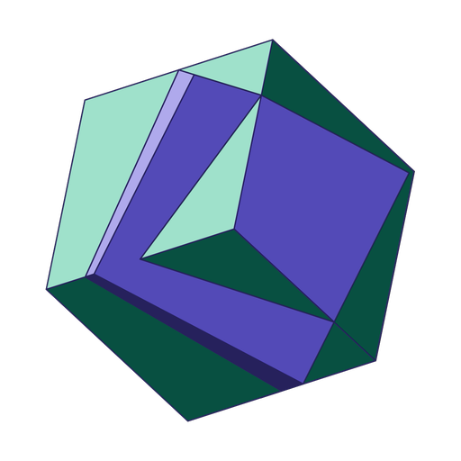

<p align="center"></p>

# Cubra

A desktop CAD program for designing 3D prints, for Linux. You build parts from solid
shapes, shape them with tools such as fillet, chamfer and press-pull, and export STL or
3MF for your slicer. A local AI assistant can turn a request such as "a 60 x 40 x 20 mm
box with a 2 mm wall" or "create a car" into a design, running entirely on your own GPU.

## Features

- **Shapes:** box, cylinder, cone, sphere, torus, wedge, polygon prism, star, gear
  (involute teeth), coil, capsule, ellipsoid and curved rod.
- **Modify:** fillet, chamfer, press-pull, split solid, and rounding of points.
- **Bodies:** each body keeps its own history. Move, rotate and scale them, combine them
  (merge, subtract, intersect, separate), snap, align, group, and pattern them
  (rectangular, circular, along a path, mirror).
- **Workspace:** view cube, grid and snap settings, a parts drawer, and adjustable bed size.
- **Export:** STL and 3MF. Bodies are fused into one watertight mesh on export.
- **Help:** ask the assistant "how do I round an edge?" and it answers from the built-in
  how-to manual ([src/ai/manual.md](src/ai/manual.md)), then walks you through the steps
  with arrows on the real buttons. It works without a model too. A test checks that
  every toolbar button and menu item is covered by the manual.
- **AI assistant:** uses [Ollama](https://ollama.com). It picks a model that fits your
  graphics card's free memory and downloads it when needed. Cubra checks the result and
  repairs common mistakes, such as loose parts or a design floating above the bed.

The geometry kernel is [Manifold](https://github.com/elalish/manifold), so every result
is a closed, printable solid.

## Building

You need CMake 3.21 or newer, a C++20 compiler, Git, and Qt 6.4 or newer (Core, Gui,
Widgets, Network, OpenGL, OpenGLWidgets and Test). On Ubuntu:

```sh
sudo apt install build-essential cmake git qt6-base-dev libgl-dev
cmake -S . -B build
cmake --build build -j
```

Manifold is downloaded and built automatically during the first build.

To add Cubra to your desktop's app list, with its icon:

```sh
cmake --build build --target desktop-entry
```

## Running

```sh
./build/cubra [design.cubra]
```

Designs are saved as `.cubra` files. Files from Cubra's earlier name, `.3design`, also
open.

The command-line tool exports designs and runs the AI without opening a window:

```sh
./build/cubra-cli design.cubra --stl out.stl --3mf out.3mf
./build/cubra-cli ai "create a car" car.cubra
./build/cubra-cli help "how do I make a hole?" qwen2.5-coder:7b
```

`CUBRA_AI_TRACE=1` prints every raw model reply, and `cubra-cli replay REPLY.json OUT.cubra`
rebuilds a saved reply without a model, for tuning the prompt.

## Tests

```sh
./build/td_tests        # geometry, files and AI parsing
./build/td_gui_tests    # the interface; needs a display
```

## Status

Early development. Tweak, Split Face, Shell, Joint and Sketch tools show their steps but
don't change the design yet.

## Licence

MIT. See [LICENSE](LICENSE).
